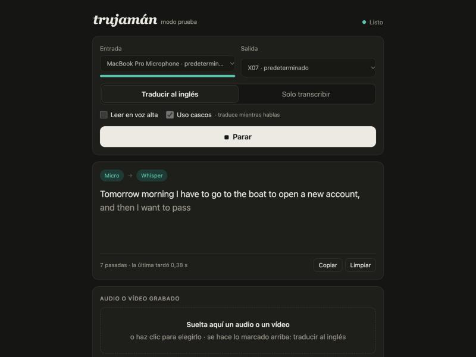

# trujamán

> *trujamán*: intérprete, el que traduce de viva voz entre dos lenguas.

Voz a texto en el Mac, sin internet ni APIs de pago. Transcribe en español, traduce al
inglés, lo lee en alto y hace de intérprete en tiempo real. Todo corre en local con
[whisper.cpp](https://github.com/ggerganov/whisper.cpp).

Se maneja desde una página local, sin tocar la terminal: eliges micrófono y salida,
pulsas *Escuchar* y ves la traducción formarse mientras hablas. También acepta audios y
vídeos arrastrados a la ventana.



Es un banco de pruebas: scripts pequeños para ver qué da de sí Whisper y llevarse las
piezas a una app. La explicación larga (modelos, medidas, por qué cada decisión) está en
[GUIA.md](GUIA.md).

## Requisitos

| Qué | Para qué | Cómo se instala |
|---|---|---|
| Mac con Apple Silicon | Whisper usa la GPU (Metal) | |
| `whisper-cpp` | Ejecuta los modelos: `whisper-cli`, `whisper-server`, `whisper-stream` | `brew install whisper-cpp` |
| `ffmpeg` | Graba del micro y convierte audio | `brew install ffmpeg` |
| `python3` (3.9 o más) | Interfaz web y motor del intérprete. Sin paquetes extra: solo la biblioteca estándar | Viene con las herramientas de Xcode, o `brew install python` |
| `swiftc` | Compila el locutor (la voz del intérprete) | `xcode-select --install` |
| `say` | Voces para leer en alto | Viene con macOS |
| 2 modelos (unos 1,1 GB) | `large-v3-turbo` transcribe; `medium` traduce | Los baja `doctor.sh --arreglar` |

No hay `pip install`, ni `npm`, ni entorno virtual.

## Puesta en marcha

```bash
brew install whisper-cpp ffmpeg
```

```bash
git clone https://github.com/juanko6/trujaman.git && cd trujaman
```

```bash
scripts/doctor.sh --arreglar
```

`doctor.sh` revisa programas, modelos y locutor, y dice qué falta y cómo arreglarlo.
Con `--arreglar`, además descarga los modelos que falten a `modelos/` y compila el
locutor. Se puede repetir: lo que ya está no lo vuelve a hacer.

Si algo deja de funcionar, lo primero es `scripts/doctor.sh`.

## Uso: la interfaz

Doble clic en `Trujaman.command`, o desde la terminal:

```bash
scripts/servidor.sh
```

Se abre `http://127.0.0.1:8178` en el navegador. La página sale al instante; los
modelos tardan unos 4 s en cargar y el punto de arriba pasa a *Listo*.

- **Entrada y salida:** los micrófonos y las salidas de audio se detectan solos y la
  lista se actualiza al conectar o quitar un dispositivo.
- **Traducir al inglés / Solo transcribir:** vale para el micro y para los ficheros.
- **Uso cascos:** se marca sola según la salida elegida. Con cascos traduce mientras
  hablas; con los altavoces del Mac espera a cada pausa, para no oírse a sí mismo.
- **En vivo:** el texto firme sale en negro y lo que Whisper aún está decidiendo, en
  gris. Los pasos *Micro → Whisper → Voz* se encienden cuando trabaja cada uno.
- **Audio o vídeo grabado:** suéltalo en la ventana; el texto se puede copiar o
  descargar como `.txt`.

La primera vez, macOS pedirá permiso de micrófono para la app desde la que lo lanzas
(Terminal, iTerm, VS Code…). Sin ese permiso el micro entrega silencio y no da ningún
error; la página avisa a los 4 s si pasa.

Solo escucha en tu máquina (`127.0.0.1`) y rechaza órdenes que vengan de otra web.
Para cerrarlo, `Ctrl+C` o cierra la ventana de Terminal.

## Uso: la terminal

Todo lo de la interfaz se puede hacer también con scripts, desde la carpeta del proyecto.

| Quiero… | Comando |
|---|---|
| Dictar 10 s y tener el texto en el portapapeles | `scripts/dictar.sh 10` |
| Dictar hasta pulsar `q` | `scripts/dictar.sh` |
| Transcribir un audio o vídeo que ya tengo | `scripts/transcribir.sh nota.m4a` |
| Lo mismo, traducido al inglés | `INGLES=1 scripts/transcribir.sh nota.m4a` |
| Dictar, traducir al inglés y oírlo | `INGLES=1 HABLAR=1 scripts/dictar.sh 10` |
| **Intérprete simultáneo** (con cascos) | `AURICULARES=1 scripts/interprete.sh` |
| Intérprete frase a frase (con altavoces) | `scripts/interprete.sh` |
| Solo subtítulos en inglés mientras hablo | `SIN_VOZ=1 scripts/interprete.sh` |
| Subtítulos en español mientras hablo | `scripts/en-vivo.sh` |
| Leer un texto en alto | `scripts/hablar.sh "Hello there"` |
| Abrir la interfaz y dar servicio a otras apps por HTTP | `scripts/servidor.sh` |
| Ver los micrófonos | `scripts/grabar.sh --lista` |

Los ajustes van como variables delante del comando:

```bash
MICRO=":MacBook Pro Microphone" VOZ=Daniel AURICULARES=1 scripts/interprete.sh
```

| Variable | Por defecto | Qué cambia |
|---|---|---|
| `MICRO` | `:default` | Micrófono: el de macOS, o por nombre (`":MacBook Pro Microphone"`) |
| `IDIOMA` | `es` | Idioma en que hablas (`en`, `auto`…) |
| `INGLES` | | Con `1`, traduce al inglés en vez de transcribir |
| `MODELO` | según `INGLES` | Ruta a otro modelo `.bin` |
| `VOZ` | `Mónica` / `Samantha` | Voz de macOS (`say -v '?'` las lista) |
| `VOCABULARIO` | | Nombres propios que Whisper falla: `"Kubernetes, LinkedIn"` |
| `PUERTO` | `8178` | Puerto de `servidor.sh` |

Los ajustes finos del intérprete (`PAUSA`, `UMBRAL`, `INTERVALO`, `RESERVA`…) están en
la [guía](GUIA.md#en-tiempo-real-intérprete).

## Cómo funciona

Hay dos modelos porque cada uno hace bien una cosa: `large-v3-turbo` transcribe mejor y
más rápido, pero no sabe traducir; `medium` sí traduce (solo al inglés). Los scripts
eligen el que toca según lleves `INGLES=1` o no.

**Dictar y transcribir** es una cadena de tres pasos:

```
micro ──ffmpeg──▶ WAV 16 kHz mono ──whisper-cli──▶ texto ──▶ pantalla, .txt, portapapeles
                                                        └──say──▶ altavoces (HABLAR=1)
```

**El intérprete** mantiene todo cargado y en marcha a la vez, para que cada frase
tarde lo mínimo:

```
ffmpeg (micro siempre abierto)
   │ audio
   ▼
simultaneo.py ──cada 0,5 s: la frase en curso──▶ whisper-server (modelo cargado)
   │                                              │ traducción provisional
   │◀─────────────────────────────────────────────┘
   │ compara con la pasada anterior: lo que coincide es firme
   ▼
locutor (Swift, voz cargada) ──▶ cascos
```

Con el audio a medias, Whisper acierta el principio de la frase y se inventa el final.
Por eso solo se dice lo que dos pasadas seguidas traducen igual; al callar, se traduce
la frase entera y se dice lo que faltaba. Va entre 1,5 y 2 s por detrás de la voz.

Con altavoces no puede ser simultáneo: el micro oiría la traducción. Entonces se
silencia mientras el locutor habla y va frase a frase.

**La interfaz** no toca el audio: es una página que manda órdenes y pinta lo que pasa.

```
navegador ──órdenes (POST /api/…)──▶ ui.py ──▶ 2 whisper-server (transcribir y traducir)
          ◀──eventos en vivo (SSE)──        ├─▶ simultaneo.py (uno por sesión de escucha)
                                             └─▶ locutor (voz y lista de dispositivos)
```

`ui.py` usa solo la biblioteca estándar de Python y `ui.html` es un único fichero sin
librerías ni CDN.

## Qué hay en la carpeta

```
trujaman/
├── README.md          esto
├── GUIA.md            la explicación larga, paso a paso
├── Trujaman.command   doble clic: arranca y abre la interfaz
├── modelos/           los .bin de Whisper (no van a git: pesan 1,1 GB)
├── audio/             grabaciones y sus .txt
└── scripts/
    ├── doctor.sh      revisa dependencias; con --arreglar baja modelos y compila
    ├── servidor.sh    arranca la interfaz web y la API
    ├── ui.py          el servidor de la interfaz
    ├── ui.html        la página
    ├── comun.sh       configuración que comparten todos
    ├── grabar.sh      micro → WAV
    ├── transcribir.sh audio → texto (o traducción)
    ├── dictar.sh      grabar + transcribir + portapapeles (+ voz)
    ├── hablar.sh      texto → altavoces
    ├── interprete.sh  arranca el intérprete
    ├── simultaneo.py  el motor del intérprete
    ├── locutor/       la voz del intérprete (Swift)
    └── en-vivo.sh     subtítulos en el mismo idioma
```

## Si algo falla

| Síntoma | Causa |
|---|---|
| Sale "Gracias por ver el video" u otra frase que no has dicho | El audio está en silencio y Whisper se la inventa. Falta el permiso de micrófono o el micro elegido no es el bueno |
| El intérprete avisa de que el micro "solo entrega silencio" | Lo mismo. Prueba `MICRO=":nombre"` con un nombre de `scripts/grabar.sh --lista` |
| El intérprete no reacciona cuando hablas | Te oye por debajo del umbral: `UMBRAL=0.5%` |
| Con cascos Bluetooth se oye mal | macOS ha pasado también el micro a los cascos. Usa `MICRO=":MacBook Pro Microphone"` |
| `INGLES=1` devuelve español | Estás forzando el modelo turbo con `MODELO=`; no sabe traducir |
| Falla nombres propios | `VOCABULARIO="..."` |

Más casos en la [guía](GUIA.md#9-problemas-típicos).

## Licencia

[MIT](LICENSE). Los modelos de Whisper y whisper.cpp tienen sus propias licencias (también MIT).

## Contribuir

La rama `main` está protegida: los cambios entran por *pull request* y necesitan la
revisión del autor antes de fusionarse.
